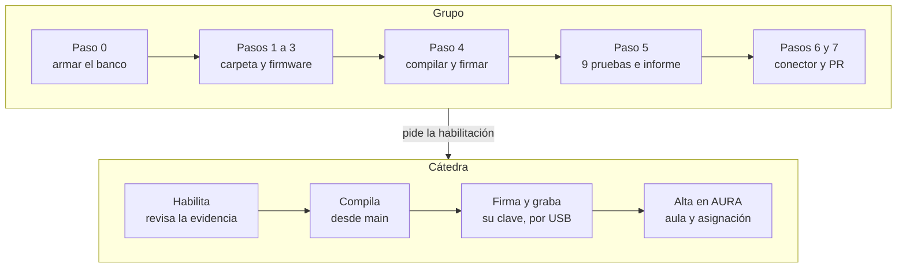

# Guía para hojas nuevas de AURA: del banco a la red final

> **Borrador para revisión de la cátedra.** No es una versión final. Las decisiones de planteo están al final, en «Decisiones para revisar», para que se puedan comentar una por una.

Última actualización: 14/11/2026.

## Para la IA que acompaña a un grupo

Esta guía está escrita para que un asistente de IA la lea y guíe a un grupo de estudiantes hasta que su hoja quede habilitada. Está basada en `main` al 13/11/2026 (commit `12eb411`): si algo de acá no coincide con el repo, vale el repo, y hay que avisárselo al grupo.

1. **Guiar en orden, un paso por vez,** y pedir la evidencia de cada uno antes de seguir: la salida de la terminal o del monitor serie, no un "ya está".
2. **Los comandos son para Windows:** la terminal de ESP-IDF es PowerShell. Si el grupo usa Linux o macOS, adaptarlos.
3. **Nunca pedir, escribir ni repetir credenciales ni claves:** ni el ID y la clave de la mesh, ni el usuario y la clave del broker, ni claves de firma. Si un estudiante las pega en la conversación, no repetirlas, y recordarle que no van al repo, ni a un PR, ni a un issue.
4. **No dar por aprobada una prueba sin su evidencia,** ni saltear ninguna de las del paso 5.
5. **Las credenciales de la red final y la firma definitiva son de la cátedra.** Sin atajos: ni firmar con una clave propia para la red final, ni pedirle las credenciales a otro grupo.
6. **El código común no se toca en el PR del dispositivo:** `comun/`, `infraestructura/` y la biblioteca de `Mesh_Red_Completa/componentes/` afectan a todas las placas. Un cambio ahí va en un issue o en un PR aparte.
7. **Ante un error, buscar primero en "Errores comunes"** y en la sección 5 de `GUIA_NODOS_HOJA.md`, antes de proponer cambios de código.
8. **El PR lo revisa también un proceso automático de la cátedra,** que deja un comentario en GitHub (paso 7): ayudar al grupo a leerlo y a responder cada punto.
9. **Lo marcado como pendiente no se inventa:** el grupo lo confirma con la cátedra.
10. **Si el grupo todavía no tiene su banco armado,** empezar por `GUIA_BANCO_DE_PRUEBAS.md` (paso 0).

## El recorrido, del banco a la red final

Una hoja nueva pasa a la red final recién cuando pasó las pruebas del banco y su código está en `main`. Después del merge, la cátedra compila desde `main` con las credenciales de la instalación, firma esa imagen y la graba. Hasta ahí, el grupo trabaja con su banco y su propia clave de prueba, y nunca recibe las credenciales de la red final.

**Paso 0:** antes de empezar, el grupo arma su banco de pruebas (gateway, concentrador, broker y tablero propios) con `Mesh_Red_Completa/GUIA_BANCO_DE_PRUEBAS.md`, que está en un PR aparte.



El paso del grupo a la cátedra es el pedido de habilitación: sin las pruebas aprobadas y el PR mergeado, la cátedra no compila ni firma.

## Paso 1: crear la carpeta del dispositivo

Toda hoja nueva parte de la hoja de ejemplo de la cátedra, `Mesh_Red_Completa/Mesh3_Hoja/`, que ya trae la biblioteca, la OTA y la firma configuradas.

1. **Primer PR, una vez por persona:** su archivo en `docs/contribuidores/`. Hasta tener un commit mergeado, el CI de sus PR no corre sin la aprobación manual de la cátedra.
2. **Fork y rama** de `Universidad-Nacional-de-Rafaela/aura-firmware`.
3. **Código del dispositivo**, armado con el mapa de `dispositivos/README.md` (por ejemplo, `E1-PB-LECA-TAB01`).
4. **Copiar `Mesh_Red_Completa/Mesh3_Hoja/` como `dispositivos/<CÓDIGO>/`**, en una ruta sin espacios ni tildes, y fuera de Google Drive u OneDrive.
5. **Ajustar el `CMakeLists.txt` de la carpeta:**
    - `set(EXTRA_COMPONENT_DIRS "${CMAKE_CURRENT_LIST_DIR}/../../Mesh_Red_Completa/componentes")`
    - `set(PROJECT_VER "1.0.0")`: la versión, que se sube en cada entrega.
    - `project(aura-<uso>)`: el tipo de firmware, por ejemplo `aura-energia-pm2130`. Rige la regla de `GUIA_NODOS_HOJA.md` (2.7): `CONTRIBUTING.md` todavía dice "tu código en minúsculas", pero el tipo es por uso, no por instalación.
6. **Completar la ficha** (`README.md` de la carpeta): ubicación, responsables, hardware y conexionado, campos de `values`, alertas y parámetros de `set_config` con su valor en esa placa.
7. **Sumar el dispositivo** a la tabla de `dispositivos/README.md`, y la carpeta a `.github/CODEOWNERS` con los usuarios de GitHub del grupo.

| Archivo | Qué tiene que tener |
| --- | --- |
| `CMakeLists.txt` | `EXTRA_COMPONENT_DIRS`, `PROJECT_VER` y `project(aura-<uso>)` |
| `sdkconfig.defaults` | El target y la flash de la placa, sin sacar las líneas de la vuelta atrás y la firma (paso 2) |
| `partitions.csv` | `otadata`, `ota_0`, `ota_1` y `cola`, igual que en `Mesh3_Hoja` |
| `main/main.c` | La lógica propia del dispositivo (paso 2) |
| `main/config_local.ejemplo.h` | La plantilla de los datos de la mesh. Se sube; el `config_local.h` no |
| `README.md` | La ficha completa |
| `tests/` con `Makefile` | Los tests que corren sin placa, si la lógica se puede probar así: el CI los corre solo |

## Paso 2: la lógica obligatoria del firmware

El grupo escribe solo lo propio del dispositivo; la biblioteca `nodo_mesh` hace la unión a la malla, el aula, la cola, los reintentos, la hora, la OTA y la verificación de la firma. El detalle de la API está en `GUIA_NODOS_HOJA.md`, sección 2.

**Lo que se escribe en `main/main.c`:**

1. **`nodo_mesh_iniciar(&cfg)`**, una vez, después de `nvs_flash_init()`. Lleva el ID y la clave de la mesh de `config_local.h`, `potencia_tx`, `alimentacion` y las tres funciones de abajo.
2. **La medición**, en una tarea propia, cada `intervalo_s`: `nodo_mesh_medicion(values)`.
    - En `values` van solo mediciones válidas, con nombres en minúsculas y la unidad: `temp_c`, `v_an_v`, `p_w`.
    - Una sonda que falla no se manda: ni centinela ni `null`. Se informa con `nodo_mesh_sonda(campo, ok, motivo)`.
    - Los decimales van como `double` redondeados, y el JSON no puede pasar de 160 bytes.
3. **`aplicar_config`**: valida todos los parámetros y solo si todos son válidos los aplica y los guarda en NVS. Ignora `aula`, que la maneja la biblioteca. Si algo no valida, devuelve `false` con un motivo (`intervalo_s_fuera_de_rango`, `parametro_desconocido`).
4. **`describir_config`**: la configuración vigente, con `intervalo_s` siempre. Con eso, el gateway marca la placa como `offline` si pasa 3 intervalos sin hablar.
5. **`ejecutar_comando`**, si la placa acciona algo: devuelve `true` solo si ejecutó.

**Lo que no se hace:** ni MAC, ni ID, ni aula en el código; ni llamadas a `esp_mesh_*` o `esp_wifi_*`, porque la radio la maneja la biblioteca; ni bloquear `app_main`, porque la actualización llega mientras la placa mide.

**Lo que tiene que quedar en `sdkconfig.defaults`,** porque sin esto no hay OTA ni firma:

```
CONFIG_PARTITION_TABLE_CUSTOM=y
CONFIG_PARTITION_TABLE_CUSTOM_FILENAME="partitions.csv"
CONFIG_BOOTLOADER_APP_ROLLBACK_ENABLE=y
CONFIG_SECURE_SIGNED_APPS_NO_SECURE_BOOT=y
CONFIG_SECURE_SIGNED_APPS_RSA_SCHEME=y
CONFIG_SECURE_SIGNED_ON_UPDATE_NO_SECURE_BOOT=y
```

Si falta la verificación de firma, la compilación se frena con un `#error`. El firmware completo tiene que entrar en 1,75 MB: `idf.py build` lo informa al final ("Smallest app partition is…").

**Recomendado:** que un `intervalo_s` nuevo rija enseguida, midiendo en ese momento, en lugar de esperar lo que quedaba del intervalo anterior. Está resuelto así en `dispositivos/E1-PB-LECA-TAB01/main/main.c`.

## Paso 3: configuración local y lo que nunca se sube

En el banco se trabaja con dos cosas que no van al repo: los datos de mesh del banco y una clave de firma de prueba del grupo. El repo es público, y el CI rechaza cualquier `config_local.h` versionado.

1. **Los datos de la mesh:** los que el grupo generó para su banco (paso 0). Lo más seguro es copiar el `config_local.h` del gateway del banco como `main/config_local.h`, en lugar de tipear: un carácter distinto y la placa no entra a la malla.
2. **La clave de firma de prueba,** generada una vez por grupo y guardada fuera del repo, por ejemplo en `C:\aura-claves\`:

    ```
    python -m espsecure generate-signing-key --version 2 --scheme rsa3072 C:\aura-claves\firma_prueba.pem
    ```

3. **Una copia de esa clave en un pendrive,** nunca en la nube ni en el repo. Las placas grabadas con ella solo aceptan actualizaciones firmadas con ella: si se pierde, hay que volver a grabarlas por USB.

**Nunca se sube:** `config_local.h`, `credenciales.h` (el del gateway), ninguna clave (`*.pem`, `*.key`, `claves/`), ni MAC, IP o ruta de producción. El `.gitignore` de la raíz los excluye, y el CI corre `gitleaks` sobre toda la historia.

## Paso 4: compilar, firmar y grabar en el banco

La compilación no firma: se compila, se firma aparte con la clave de prueba, se verifica, y recién después se graba. La primera grabación va por USB y con la flash borrada. Todo desde la terminal de ESP-IDF (PowerShell), parados en `dispositivos\<CÓDIGO>`:

```
idf.py set-target esp32c3
idf.py build
python ..\..\Mesh_Red_Completa\Broker_MQTT\firmar.py --clave C:\aura-claves\firma_prueba.pem build\<tipo>.bin
idf.py -p COMx erase-flash
idf.py -p COMx flash monitor
```

`<tipo>` es el nombre del `project(...)`, por ejemplo `aura-energia-pm2130`. `firmar.py` firma la imagen, verifica la firma y se niega a firmar dos veces la misma imagen.

- **Firmar una sola vez** cada imagen: con `espsecure` directo, firmar dos veces la deforma sin aviso; `firmar.py` lo impide.
- **El aviso `App built but not signed` aparece siempre** al compilar, aunque la imagen ya esté firmada.
- **`idf.py flash` no recompila si no cambió nada,** y graba la imagen firmada. Si se cambió algo después de firmar, hay que compilar y firmar de nuevo.
- **Grabar siempre una imagen firmada:** una placa que arranca con una imagen sin firma no acepta ninguna OTA.
- **Si la placa tiene fuente propia,** desconectarla mientras está por USB: dos fuentes a la vez pueden meter tensión en el USB de la notebook.

## Paso 5: pruebas obligatorias en el banco

Una hoja queda habilitada cuando pasa estas 9 pruebas en el banco y deja la evidencia en el repo. Se hacen en el banco del grupo (paso 0, `GUIA_BANCO_DE_PRUEBAS.md`), con `broker.py`, el tablero y `ota.py` (ver `Mesh_Red_Completa/Broker_MQTT/LEEME.md`).

| N.º | Prueba | Cómo | Resultado esperado |
| --- | --- | --- | --- |
| 1 | Alta y aula | Encender la placa recién grabada y asignarle un aula desde el tablero, en minúsculas | Aparece pendiente, pasa a `modo: aula` y llegan los `data` con `ts`, confirmados (`persistido`) |
| 2 | `set_config` inválido | Mandar un parámetro fuera de rango junto con uno válido | `rechazado` con motivo, y la configuración queda igual |
| 3 | Plan B | Apagar el concentrador del aula | La placa pasa a `directo`, no pierde datos y vuelve sola a `aula` |
| 4 | OTA normal | `ota.py` con la imagen firmada y la versión subida | `aplicado`, y el tablero muestra la versión nueva |
| 5 | Misma versión | `ota.py` con la imagen que ya tiene | `aplicado` sin cambios, sin instalar nada |
| 6 | Imagen sin firma | `ota.py` con una imagen compilada y no firmada | `rechazado` (`imagen_invalida`), y sigue con la versión anterior |
| 7 | Otra clave | `ota.py` con una imagen firmada con una segunda clave de prueba | `rechazado` (`imagen_invalida`) |
| 8 | Vuelta atrás | `ota.py` con una versión compilada con otro `MESH_ID_BYTES`, que no puede volver a la malla | En 10 min como máximo vuelve sola a la anterior: `rechazado` (`volvio_a_la_version_anterior`), y recupera las mediciones que guardó |
| 9 | Ningún dato perdido | Contar en el `mensajes.log` del broker los `data` y sus `ack` durante todas las pruebas | Cada medición confirmada una vez: sin pérdidas ni duplicados |

**Recomendada:** cortar la energía del gateway en medio de una OTA. La transferencia tiene que volver a empezar sola y terminar en `aplicado`.

**La evidencia** va en `dispositivos/<CÓDIGO>/pruebas/<AAAA-MM-DD>-<tema>/README.md`: el procedimiento, el resultado de cada caso con extractos de los registros que lo respaldan (sin MAC, IP ni rutas), y lo que no se pudo probar. Los dos informes de `dispositivos/E1-PB-LECA-TAB01/pruebas/` sirven de modelo.

## Paso 6: el conector de AURA

Sin conector, AURA no guarda lo que manda la placa: lo que no está declarado, o está fuera de rango, se descarta. El detalle está en `CONTRIBUTING.md`, sección 3.

1. **Copiar `ejemplos/plantilla_conector/` como `conectores/<CÓDIGO>/`**, con el mismo código que el dispositivo.
2. **En `conector.toml`:** `nombre` igual a la carpeta, los usuarios de GitHub del grupo, y un bloque `[campos.<nombre>]` por cada campo que manda el firmware, con su unidad, su rango físico, su `etiqueta` (hasta 40 caracteres) y su `rol` (`principal`, `auxiliar` u `oculto`).
3. **En `conector.py`:** `al_recibir_datos(self, msg, ctx)` decide qué guardar (`ctx.guardar_medicion`) y qué descartar, y emite las alertas.
4. **Tests con `ContextoDePrueba`,** que corren sin AURA ni placa: `python3 -m unittest discover -s conectores/<CÓDIGO>/tests`. Conviene sumar mediciones reales del banco, como `tablero_real.jsonl` en `conectores/E1-PB-LECA-TAB01/tests/`.
5. **Probarlo como corre en AURA,** en un proceso aparte y con límites de memoria y tiempo: `herramientas/correr_conector.py conectores/<CÓDIGO> --archivo mensajes.jsonl --subproceso`.

Los nombres de los campos del `conector.toml` tienen que ser exactamente los de `values` en el firmware.

## Paso 7: entregar y pedir la habilitación

Con las pruebas aprobadas y el PR mergeado, el grupo pide la habilitación. A partir de ahí, la cátedra compila, firma y graba: el grupo entrega el código, no un `.bin`, y no recibe las credenciales de la red final (`GUIA_NODOS_HOJA.md`, 2.9).

**Lo que hace el grupo:**

1. **Abrir el PR contra `main`,** con el checklist de la plantilla completo: dispositivo, conector, ficha, tests e informe de pruebas.
2. **Atender la revisión.** Además del CI de GitHub, la cátedra tiene una máquina que, con procesos en segundo plano, descarga cada PR, vuelve a correr las validaciones y deja un comentario en el PR con lo que encontró. Cada punto se corrige en la misma rama (el PR se actualiza solo) y se contesta en el PR. Puede haber varias rondas hasta que lo mergean.
3. **Pedir la habilitación a la cátedra,** con el enlace al informe de pruebas, el `hw_id` de la placa (`mac-…`) y su tipo y versión de firmware.

**Lo que hace la cátedra:**

1. **Revisa la evidencia** y habilita el dispositivo.
2. **Compila desde `main`** con las credenciales de la instalación. No firma `.bin` compilados por otros, y la imagen no se publica, porque lleva las credenciales de la malla.
3. **Firma esa imagen con su clave,** hoy desde la notebook del profe y, a futuro, en un servidor de firmas junto al nginx que sirve las imágenes. La clave definitiva nunca sale de ahí.
4. **Primera grabación por USB,** con `erase-flash` y la imagen firmada por la cátedra. Desde ahí, la placa solo acepta actualizaciones firmadas con esa clave. Si una placa ya quedó grabada con la clave de prueba de un grupo, cómo cambiarla está en `Mesh_Red_Completa/MIGRACION_FIRMA.md`.
5. **Alta en AURA:** con su primera medición, la placa aparece en "Placas sin asignar". La cátedra la asigna al código del dispositivo y le asigna el aula, en minúsculas; si es un concentrador, además lo autoriza.

**Después, cada actualización** sigue el mismo camino: el grupo sube los cambios por PR con el `PROJECT_VER` aumentado, y la cátedra la firma y la manda por OTA desde AURA.

## Errores comunes

Todos salieron en el banco de `E1-PB-LECA-TAB01`; los problemas de la malla en general están en `GUIA_NODOS_HOJA.md`, sección 5.

| Síntoma | Causa | Solución |
| --- | --- | --- |
| La placa no entra a la malla: el gateway no muestra `Hijo conectado` | `config_local.h` con los valores de la plantilla, o con un carácter distinto | Copiar el `config_local.h` de una placa que funciona, y recompilar |
| Después de cambiar `config_local.h`, `idf.py build` hace 5 pasos y no recompila | `copy` conserva la fecha del archivo original, y la compilación decide por fecha | Borrar la carpeta `build` y compilar de nuevo |
| La compilación se frena con un `#error` sobre la firma | Un `sdkconfig` de antes de las imágenes firmadas | Borrar `sdkconfig` y `build`, y compilar de nuevo |
| La OTA termina en `imagen_invalida` con la clave correcta | La imagen se firmó dos veces, no se firmó, o la placa se grabó con otra clave | Compilar, firmar una vez y verificar; si la placa tiene otra clave, grabarla por USB |
| El aula queda `rechazado` (`aula_invalida`) | Tiene mayúsculas | Solo `a-z`, `0-9`, `-` y `_`: `e1-pb-leca`, no `E1-PB-LECA` |
| La placa arranca con un aula vieja, o el gateway muestra placas que ya no existen | Se grabó sin `erase-flash`: la NVS conserva lo anterior | `erase-flash` antes de grabar |
| La hoja está viva pero aparece `offline`, con los `pendientes` subiendo | Después de un corte, espera hasta unos 7,5 min para reintentar | Esperar: se recupera sola. Reiniciarla acorta la espera |
| `ota.py` o el tablero no ven las placas, aunque el gateway publica | Un Mosquitto instalado como servicio de Windows ocupa el puerto 1883 | `--broker <IP de la notebook>`, o detener el servicio |

## Dónde está cada cosa en el repo

Todo está en `main` de [Universidad-Nacional-de-Rafaela/aura-firmware](https://github.com/Universidad-Nacional-de-Rafaela/aura-firmware), salvo lo que se indica.

| Ruta | Qué tiene |
| --- | --- |
| `CONTRIBUTING.md` | Cómo sumar un dispositivo: carpeta, conector, lo que no se negocia y el PR |
| `Mesh_Red_Completa/GUIA_NODOS_HOJA.md` | La guía de la cátedra: API de la biblioteca, reglas, OTA (2.8), firma (2.9), checklist (3) y problemas frecuentes (5) |
| `docs/CONTRATO_MQTT.md` | El contrato: qué va en `values` (3.1), `set_config` (3.3) y alertas (3.5) |
| `docs/adr/ADR-008-actualizacion-por-la-malla-y-tipo-de-firmware.md` | La OTA y el tipo de firmware |
| `Mesh_Red_Completa/Mesh3_Hoja/` | La hoja de ejemplo: la plantilla para copiar |
| `Mesh_Red_Completa/componentes/nodo_mesh/` | La biblioteca de las hojas |
| `Mesh_Red_Completa/Broker_MQTT/` | El banco: `broker.py`, el tablero, `ota.py`, las herramientas (`firmar.py`, `pem_a_define.py`, `buscar_brokers.py`, `mandar_comando.py`) y su `LEEME.md` |
| `ejemplos/plantilla_conector/` | La plantilla del conector |
| `dispositivos/E1-PB-LECA-TAB01/` | Una hoja completa de ejemplo: Modbus RTU por RS-485, tests sin placa e informes de prueba en `pruebas/` |
| `conectores/E1-PB-LECA-TAB01/` | Un conector completo, con tests sobre mediciones reales |
| `Mesh_Red_Completa/GUIA_BANCO_DE_PRUEBAS.md` (en un PR aparte) | Cómo arma cada grupo su banco de pruebas: el paso 0 |
| `Mesh_Red_Completa/MIGRACION_FIRMA.md` | Cómo cambiar la clave de placas que quedaron firmadas con una clave de prueba |

## Decisiones para revisar

1. **La guía está escrita para que la lea una IA que acompaña a un grupo.** Por qué: los grupos ya trabajan con asistentes, y unas reglas explícitas (orden, evidencia, credenciales) evitan que la IA improvise. Alternativa descartada: una guía solo para personas; de todos modos, las reglas para la IA también le sirven a una persona.
2. **El repo manda sobre la guía.** La guía fija el commit de `main` en que se basa, y si algo no coincide, vale el repo. Por qué: la guía resume documentos que van a cambiar (`GUIA_NODOS_HOJA.md`, `CONTRIBUTING.md`, el contrato). Alternativa descartada: copiar su contenido, que se desactualiza sin aviso.
3. **Toda hoja parte de `Mesh3_Hoja`.** Por qué: es la plantilla que mantiene la cátedra, y ya trae la OTA y la firma configuradas; la carpeta de otro grupo puede arrastrar decisiones propias de su dispositivo. `E1-PB-LECA-TAB01` queda como ejemplo de consulta, no como plantilla.
4. **El tipo de firmware va por uso,** como dice `GUIA_NODOS_HOJA.md` (2.7), aunque `CONTRIBUTING.md` diga «tu código en minúsculas». Por qué: es la regla del ADR-008, y la que usa la OTA para elegir placas. La discrepancia queda señalada para que la cátedra corrija uno de los dos documentos.
5. **Nueve pruebas obligatorias y una recomendada.** Cubren lo que hace falta para habilitar una hoja: el alta, la configuración, el plan B, la OTA (normal, misma versión, sin firma, otra clave y vuelta atrás) y que no se pierdan datos. El corte de energía queda como recomendada porque prueba más al gateway que a la hoja. Las pruebas de HTTPS no se piden, porque dependen del gateway y del servidor, no de la hoja.
6. **La evidencia es un informe en `pruebas/`,** con extractos de los registros sin MAC ni IP. Por qué: queda versionada junto al código, y se revisa en el mismo PR. Alternativa descartada: subir los registros completos, que la cátedra pidió no versionar.
7. **Las credenciales de la red final y la firma son solo de la cátedra,** como dice el #66: el grupo entrega código, nunca un `.bin`, y no recibe las credenciales finales. Por qué: es lo que evita que una placa de banco termine en producción, que es lo que nos pasó a nosotros (ver `MIGRACION_FIRMA.md`).
8. **Los comandos son para PowerShell,** la terminal de ESP-IDF en Windows, que es lo que usa la mayoría. La regla 2 para la IA cubre Linux y macOS.
9. **Los errores comunes salen de casos reales** del banco de E1-PB-LECA-TAB01, y no de una lista teórica.
10. **El análisis de la migración de firma va en un archivo aparte** (`MIGRACION_FIRMA.md`). Por qué: es un caso puntual, el de placas ya instaladas con una clave de prueba, y esta guía es para hojas nuevas.
11. **El armado del banco va en otra guía, como paso 0** (`GUIA_BANCO_DE_PRUEBAS.md`, en un PR aparte). Por qué: el banco se arma una vez por grupo, y la hoja se desarrolla muchas veces sobre él. Separadas, cada guía es más corta, y cada revisión también.
